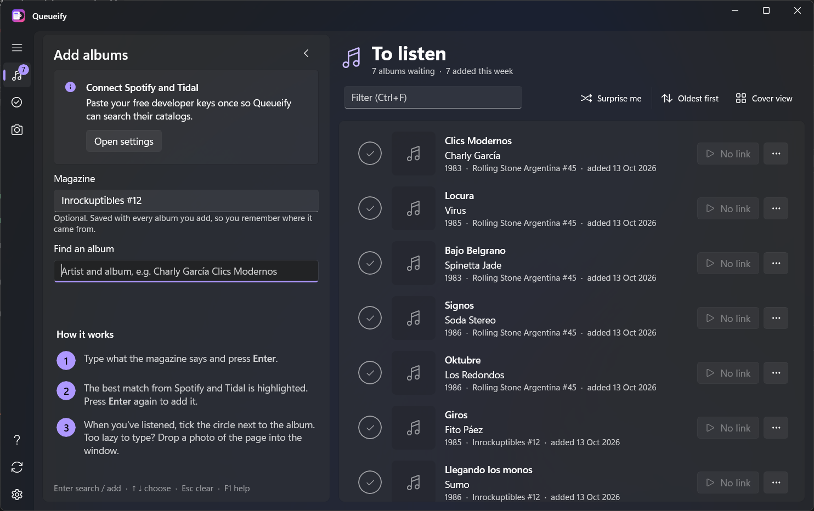
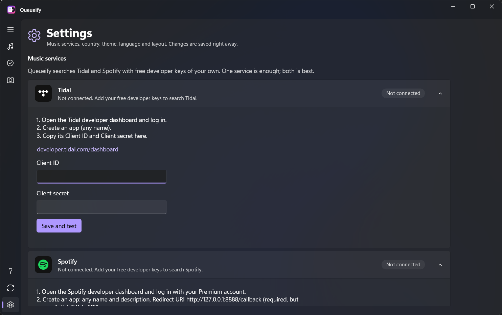

# Queueify

[](https://github.com/PAumedes/Queueify/actions/workflows/ci.yml)

A "listen later" queue for the albums your magazines recommend. Type what the magazine says (or click
it on a photo of the page), press Enter, press Enter again. Queueify finds the album on Tidal and
Spotify, saves it to your queue and opens it in the official app when you want to listen. Tick it when
you've heard it, rate it, move on.



## Features

- One search box for **Tidal and Spotify** at once; the best match is highlighted, Enter adds it
- **Magazine photos**: drop a photo of the page and click the artist and the album instead of typing
  (Windows' built-in text recognition, offline and free)
- A queue and a Listened list with ratings, filters, order, cover view and "Surprise me"
- The **same queue on all your PCs**, through your own free Google Firebase project
- **English and Spanish**, light and dark, keyboard shortcuts everywhere, a quick tour and full Help (F1)
- **One exe**, no installer; optionally portable (a `Data` folder next to the exe)

## Download

1. Download `Queueify-<version>-win-x64.exe` (about 18 MB) from the [latest release](https://github.com/PAumedes/Queueify/releases/latest).
2. Put it in a folder of its own (say `Documents\Queueify`) and run it from there.

Windows 10 (version 2004 or later) or Windows 11, 64-bit. Nothing else to install. Windows SmartScreen may
warn the first time because the app isn't signed: *More info → Run anyway*. The first start of each
version takes a moment longer, behind a small loading screen: the exe unpacks the app into `%LOCALAPPDATA%\Queueify\app` (about 70 MB)
and runs it from there. The copy of the previous version is removed by itself.

**Updates**: when a new version is out, a dot appears on Help, and Help → About offers it. *Update and restart*
downloads it, checks it against the release and puts it in place of your exe, under the same name. Help →
About → *Check for updates* asks right away; *Skip this version* stops one version from being offered at start; Settings → Updates turns off the check at start. (From 1.3.0 or
earlier, download 1.4.0 by hand once.)

Your queue, keys and layout live in `%LOCALAPPDATA%\Queueify` (Help → *Open data folder*). To move to a new
version by hand, replace the exe. Pinned to the taskbar, Queueify starts the exe you downloaded rather than its
unpacked copy; give the exe one name (say `Queueify.exe`) and keep it when you update, so the pin keeps working.

**Portable mode**: if there's a `Data` folder next to the exe that is empty or has Queueify's files in it,
Queueify keeps everything there instead, so a copy on a USB stick carries its queue along. To switch an
existing queue to portable mode, close Queueify and move the files from `%LOCALAPPDATA%\Queueify` into
that `Data` folder. (A `Data` folder with other files in it, like your own, is left alone.)

**Coming from 1.2.0?** Replace the exe. 1.2.0 left an unpacked copy in `%TEMP%\.net\Queueify` that you can
delete.

**Coming from 1.1.0 (a zip with many files)?** Don't put the new exe in the old folder: it won't start
there. Either make a new folder with the new exe and your old `Data` folder next to it (portable), or move
what's inside your old `Data` folder into `%LOCALAPPDATA%\Queueify`. Then delete the old folder.

## First steps

Queueify searches with free developer keys of your own (one service is enough; both is best). Open
**Settings** (gear at the bottom of the left bar):

- **Tidal**: create an app at <https://developer.tidal.com/dashboard>, paste its Client ID and Client
  secret into the Tidal card and click *Save and test*.
- **Spotify** (the account that owns the app needs Premium): create an app at
  <https://developer.spotify.com/dashboard> with Redirect URI `http://127.0.0.1:8888/callback` (required
  but unused) and *Web API* ticked, then paste its keys into the Spotify card.

*Save and test* runs a real search, so "Connected" means the keys work. Settings also has the app Play
opens, the country (only countries where both services work), text recognition languages, theme,
language and **Reset layout**.



## Same queue on several PCs

Click **Sync** in the left bar. On the first PC you connect a free Google Firebase project (Spark plan, no
credit card; the dialog lists every step), then paste the sync code on your other PCs. Changes go up a moment after you make them and come down when you switch back
to the window; when two PCs change the same album, the newest change wins.

Keep the sync code private: anyone who has it can see and change your queue. Someone who only knows your
Firebase project ID can't read your queue, but could use up its free daily quota; see [SECURITY.md](SECURITY.md). If you published security
rules from an earlier version, copy them again from the Sync dialog and publish them in Firebase.

## Web app (from your phone)

`Queueify.Web` is the same queue as a website you can host yourself: sign in with a password or a passkey,
add an album from your phone the moment someone recommends it, and see it on your PCs. On a phone the
**Add** page is the first thing you see after signing in, and the site installs to the home screen (PWA).
It has the same pages as the desktop app (To listen, Listened, Magazine photo, Help, Settings), English and
Rioplatense Spanish (chosen with the language button, otherwise by the browser), and light, dark or system
theme. The Spotify and Tidal keys stay on the server and are never sent to the browser.

```powershell
dotnet run --project Queueify.Web          # then open the address it prints
```

The first account that registers owns the server; after that registration is closed unless the server's
configuration sets `Queueify:AllowRegistration` to `true`. Data lives under `Queueify:DataDir`
(default `./data`, one folder per user). Design notes are in [docs/WEB_DESIGN.md](docs/WEB_DESIGN.md),
the decision in [ADR-0010](docs/adr/0010-web-app-and-shared-queue.md).

## Magazine photos

Take the photo with your phone, get it onto the PC (Phone Link, WhatsApp Web, OneDrive…) and drop it into
the window, paste it with Ctrl+V or use *Open photo*. Click the artist line, then the album line.

For accents and ñ, install Spanish text recognition once per PC: *Install Spanish* on the photo page, or
Settings → *Text recognition*, which also installs English, Portuguese, French, Italian and German.
Windows asks for an administrator's permission. If anything goes wrong (permission declined, no
internet, updates managed by an organization), Queueify says what happened and how to go on.

## Privacy

Queueify has no servers and no telemetry. It talks to Tidal and Spotify (searches, with your keys), to
your own Firebase project (only if you turn on sync) and to Windows Update (only when you install a text
recognition language). Your keys are stored unencrypted in `settings.json` in the data folder, like the
rest of your data, so treat that folder as private. See [SECURITY.md](SECURITY.md).

## Contributing

Start with [CONTRIBUTING.md](CONTRIBUTING.md): building, the test suites and the workflow (test-first,
Conventional Commits, pull requests with adversarial review). Design documents live in [`docs/`](docs/):

- [Architecture](docs/ARCHITECTURE.md) · [Engineering principles](docs/ENGINEERING.md) ·
  [Testing](docs/TESTING.md) · [Releasing](docs/RELEASING.md)
- [Decision records](docs/adr/README.md) · [Agent workflow](docs/AGENT_WORKFLOW.md)

## License

[GPL-3.0-or-later](LICENSE). Spotify and Tidal are trademarks of their owners; Queueify isn't affiliated
with either. Their logos in the app come from [Simple Icons](https://simpleicons.org) (CC0).
