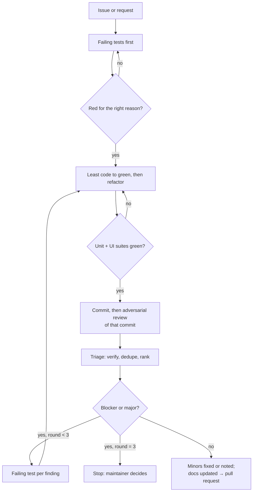

# Agent workflow: implementer and adversarial reviewers

Queueify is built with Claude Code under the maintainer's supervision. The maintainer owns every merge;
agents propose changes and the maintainer accepts or rejects them.

Agent definitions live in [`.claude/agents/`](../.claude/agents/) and procedures in
[`.claude/skills/`](../.claude/skills/).

## Pipeline

Every change gets an adversarial review, run as a separate agent that sees only the commit and the
repository, never the implementer's reasoning.

## Roles

| Agent | Writes code? | Mandate |
| --- | --- | --- |
| `reviewer-correctness` | no | Break the logic: edge cases, races, async and UI-thread issues, error paths, sync conflicts. |
| `reviewer-security` | no | Threat model: elevated scripts, untrusted JSON, secrets, Firestore rules, injection. |
| `reviewer-ux` | no | Copy in both languages, accessibility, keyboard, theme, consistency with the rest of the app. Only when the UI or texts change. |

## Adversarial rules

- Reviewers assume the change is wrong until they fail to prove it. Each finding has a **concrete
  failure scenario** and a `file:line` anchor, and for blockers and majors a proposed failing test.
- Severity: **blocker** (wrong behaviour, crash, data loss, security issue), **major** (likely bug in
  realistic conditions, untested branch), **minor** (clarity, small gaps), **nit** (taste).
- The implementer **verifies** every blocker and major before acting: a failing test or the exact code
  path. Unverifiable findings are dropped and said so.
- Fixes come test-first, as their own commit, and go back to the same reviewer for another round. Three
  rounds at most; then the maintainer decides.

## What agents never do

- Push, tag, publish a release or change repository settings without the maintainer asking.
- Touch the user's real data: the UI tests back up and restore `Data`, and scratch builds go elsewhere.
- Leave prompt-like comments, apologies, or "as an AI" text in code, commits or docs.
