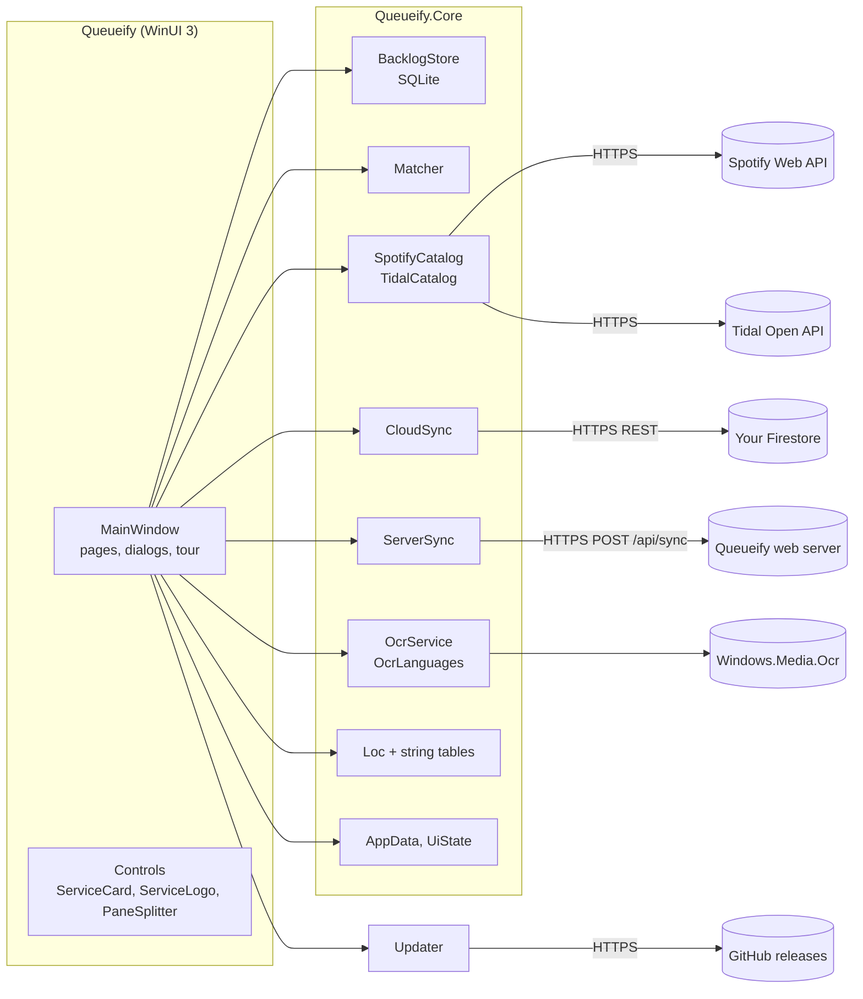

# Architecture

Queueify is a portable WinUI 3 desktop app (Windows App SDK, .NET 10, unpackaged and self-contained,
compiled ahead of time to native code). The download is one exe: a small starter with the app appended,
which it unpacks once per version into `%LOCALAPPDATA%\Queueify\app` ([ADR-0008](adr/0008-native-aot-and-a-starter-exe.md)).

## Projects

| Project | What |
| --- | --- |
| `Queueify\` | The window (`MainWindow`, split by area into `MainWindow.Photo/Sync/Updates/Settings.cs` partial classes): navigation, pages (To listen, Listened, Magazine photo, Help, Settings), dialogs, quick tour, theme, assets. `Tr.cs` is the `{l:Tr Key=…}` markup extension. |
| `Queueify.Core\` | Everything that isn't UI. No WinUI references, so it's tested directly. |
| `Queueify.Launcher\` | The download's starter: `Bundle` (append, read and unpack the app, with `X86Filter` and the LZMA SDK in `Lzma\`) and `Program` (unpack, start the app with `QUEUEIFY_EXE`, remove older versions), with `LoadingScreen` (plain Win32) covering the wait. No WinUI. |
| `Queueify.Tests\` | xUnit v3 tests for Core and the starter's `Bundle` and `X86Filter`, on Microsoft Testing Platform. |
| `tests\ui\` | PowerShell + Windows UI Automation tests that drive the published app. |
| `tests\tools\` | Tests for the release tool. |
| `tools\` | `firestore.rules` (embedded into Core), release, packaging and emulator scripts, `make-icon.ps1`; `tools\Pack\` appends the app to the starter at build time. |

## Core services

| Service | Responsibility |
| --- | --- |
| `BacklogStore` | SQLite queue. Rows carry a stable `uid`, `updated_at` (always UTC), `dirty` and soft `deleted`, for sync. Schema work and the switch to WAL run once per database file and process; a sync page is applied in one transaction (`ApplyRemoteBatch`) and `MergeBackup` takes the write lock first. |
| `AlbumYear` | The one rule for which release years are believed (1000-3000), used by the PC app, the sync client and the web server. |
| `Matcher` | Splits a typed line into text and year, merges Spotify and Tidal results, scores them. |
| `SpotifyCatalog`, `TidalCatalog` | Album search with the Client Credentials flow; tokens cached per ID and secret. |
| `CloudSync` | Firestore REST: uploads dirty rows, downloads rows newer than the last server time, shared settings. |
| `ServerSync` | The second provider ([ADR-0010](adr/0010-web-app-and-shared-queue.md)): one `POST /api/sync` round trip with a personal access token, repeated until nothing more comes. Same rules as `CloudSync` (newest `UpdatedAt` wins, soft deletions); HTTPS only, no redirects, 20 s per request, errors never carry the token. |
| `ISyncProvider`, `SyncProviders` | What `CloudSync` and `ServerSync` share: `SyncAsync(store, settings, ct)`. `AppSettings.ActiveSync` picks one; a PC uses one at a time and the web server wins if a hand-edited `settings.json` sets both. |
| `OcrService`, `OcrLanguages` | Windows OCR on a photo; which language reads it; installing languages (elevated, allow-listed). |
| `Loc`, `Strings.En/Es` | All texts, the app language and the formats that go with it. |
| `AppData`, `UiState` | Where the data folder is; `settings.json` (synced settings, keys) and `ui.json` (per-PC layout, theme, language). |
| `Countries` | The countries where both services work, named in the app language. |
| `Updater` | The latest GitHub release: whether it's newer, downloading and checking its exe, swapping it in ([ADR-0009](adr/0009-update-from-github-releases.md)). |

## Web app (`Queueify.Web`)

A Blazor Web App (.NET 10): static server rendering for the account pages, Interactive Server for the rest,
referencing `Queueify.Core` for matching, catalogs, `BacklogStore`, `QueueText` and the string tables
([ADR-0010](adr/0010-web-app-and-shared-queue.md), look and layout in [WEB_DESIGN.md](WEB_DESIGN.md)).

| Part | Responsibility |
| --- | --- |
| `Services/QueueifyUi` | `AddQueueifyUi()` and `MapQueueifyUi()`: the only lines `Program.cs` needs. Registers the services, the 20 s catalog `HttpClient`, the per-request language and the `/prefs` form endpoint. |
| `Services/UserQueue` | The signed-in user's queue for one circuit: every change is written at once to that user's `queueify.db` (`UserStores`), undo re-reads the stored album, `Changed` redraws the nav badges. A change updates only that album in memory (`LoadAsync` is the full refresh) and keeps a normalised search key per album, so filtering a queue of tens of thousands does not normalise every album per keystroke; the queue pages debounce the filter and draw 100 albums at a time. |
| `Services/AlbumSearch`, `HttpCatalogs` | Both catalogs at once with the user's own keys, the year retry, errors as readable messages; one catalog object per user so tokens are reused but never shared. |
| `Services/Prefs` | Language (cookie, then `Accept-Language`), theme, same-site return paths, where a phone lands after sign-in. |
| `LocCircuitHandler` | `Loc` keeps its language per async flow; each call into a circuit runs with the circuit's language, so two users never swap languages. |
| `Components/Layout` | `NavMenu` is one list of every page drawn as the left rail and the phone tab bar; `MainLayout` is the shell, or a bare centred card when signed out. |
| `Components/Shared`, `Pages` | `QueueBrowser` (To listen and Listened), `Add`, `Cover`, `Stars`, `Snackbar`. Decisions live in Core: `QueueView` (filter, order, the "Artist - Album" split, already-saved check) and `PlayLinks` (`spotify:` / `tidal:` with an https fallback; the desktop `ExternalLinks` uses it, and `MainWindow` can call `QueueView` instead of its own copy of the filter and order). |
| `Components/Account` | The ASP.NET Core Identity pages, restyled; registration follows `RegistrationGate`. |

Sign-in is required for every page except the account pages; the user id (never anything the browser sends)
picks the data folder.

## Data

Everything lives in `%LOCALAPPDATA%\Queueify`: `queueify.db`, `settings.json`, `ui.json` and, after a crash,
`crash.log`. A `Data` folder next to the exe takes its place when it exists (portable mode, and how 1.1.0
kept it). Copying the folder copies the queue, the keys and the sync connection.

Sync: each PC keeps its own database. Online, a queue is `queues/{key}` in the user's Firestore, where the
40-hex-character key is the capability (the sync code is `queueify:{project}:{key}`). See
[ADR-0003](adr/0003-firestore-rest-sync.md). Or the PC syncs with a Queueify web server instead, using
`WebServerUrl`, `WebToken` (per PC, never shared) and `WebLastServerTime` in `settings.json`.

## Web server and the sync endpoint

`Queueify.Web` is the shared database for people who use the web app ([ADR-0010](adr/0010-web-app-and-shared-queue.md)).
Its sync code lives in `Queueify.Web\Sync\` and is wired by `AddQueueifySync` / `MapQueueifySync`.

| Part | Responsibility |
| --- | --- |
| `UserStores` | One folder per user under `Queueify:DataDir` (default `./data`): `queueify.db` (a `BacklogStore` file), `settings.json` and `secrets.dat`. The Spotify and Tidal secrets are encrypted with Data Protection (bound to the user) into `secrets.dat` and never written to `settings.json`. The Data Protection keys are in `DataDir\keys`. |
| `PersonalAccessTokens` | Tokens `qw_` + 32 random bytes in base64url, shown once. Only the SHA-256 hash, name, created, last-used and revoked time are stored (Identity database, table `PersonalAccessTokens`). At most 20 live tokens per user. |
| `TokenAuthenticationHandler` | The `QueueifyToken` scheme: `Authorization: Bearer`. A missing, bad or revoked token is 401 with an empty body; the cookie is not accepted on `/api/sync`. It also counts every attempt against a per-address limit (`Queueify:Sync:RequestsPerMinute`, 120), so guessing is throttled (429). |
| `SyncEngine` | `POST /api/sync`: one SQLite transaction per request, one request at a time per user. |
| `ConnectPc.razor` | `/connect`: create, list and revoke tokens; the connect text (`SyncConnect.Format`) is shown once. |

How a sync works: rows changed through `BacklogStore` by the web pages are flagged `dirty`; the next sync stamps
them with a `server_time` (a column `BacklogStore` doesn't know, next to a `sync_meta` table; desktop databases
never get either) and clears the flag. Stamps are strictly increasing per user, so `since` pagination never skips
a row. Incoming rows win when their `updatedAt` is newer than the server's (a tie keeps the server's row); a row
the server refuses is stamped again, so it comes back to the sender in the same response and the PC converges.
Deletions stay as soft rows for 90 days, then each sync purges them. Behind a reverse proxy, `Queueify:Proxy:KnownProxies` / `KnownNetworks` say whose `X-Forwarded-For` to trust, so the rate limit sees client addresses. Text is cut at 500 characters, ratings and years are made valid, and an `updatedAt`
more than ten minutes ahead of the server's clock is pulled back to that, so a wrong PC clock can't win forever.
A request holds at most 1,000 albums (400 otherwise) and `Queueify:Sync:MaxBodyBytes` (8 MB, 413); a response
holds at most 1,000 albums, and when it is full its `serverTime` is the stamp of its last album, so the client
repeats until the response is empty. Settings follow the same rule with their own stamp.

## Startup

`App.OnLaunched` reads `ui.json`, sets the language (`Loc.Use` and WinUI's
`PrimaryLanguageOverride`), then creates `MainWindow`, which restores the window, loads settings and the
queue, applies the theme, and syncs once it's loaded. A language change restarts the app, because XAML
reads its texts while it loads.

## Web app: Settings, Help, Photo and data

`Queueify.Web` (Blazor Web App, Interactive Server, [ADR-0010](adr/0010-web-app-and-shared-queue.md)) keeps
one folder per user under the data root (`Queueify:DataDir`, default `App_Data`): `queueify.db`,
`settings.json` and `prefs.json`; the same root holds the account database `identity.db` (created and migrated at start;
nothing ships with the app, `ConnectionStrings:DefaultConnection` can move it). `UserStores` is the only door to them; with Data Protection (key ring in
`keys/`) it keeps the two client secrets encrypted in `secrets.dat`, bound to the user, never in `settings.json`.

| Piece | Responsibility |
| --- | --- |
| `Core: IOcr`, `WindowsOcr`, `OcrService.CleanLine` | The reader contract (plain boxes, no Windows types); the desktop adapter; the line cleanup both builds share. |
| `Ocr/` | `ImageGuard` (sniff, pixel budget, upright, scale, re-encode), `TesseractOcr` (child process, TSV), `TessdataFetcher` (pinned, checksummed models), `OcrGate` (one per user), `PhotoReader`, `POST /api/photo` ([ADR-0011](adr/0011-web-ocr.md)). |
| `Services/SettingsService`, `PreferencesStore` | Music settings with the desktop's edit rules (`AppSettings.ApplyEdits`), the key test through the catalogs, and per-user theme, language, reading language and tour state. |
| `Services/DataTransfer`, `DataEndpoints` | JSON and CSV export; import of the desktop's `queueify.db` (read through a read-only, immutable connection with the schema distrusted, never attached) or an exported JSON, through `BacklogStore`, so rows keep their `uid`. |
| `Components/Pages/Settings, Help, Photo` and `Components/Shared/Settings*, HelpTour` | The pages. Secrets are write-only: the page only ever learns "configured". `<HelpTour />` is the first-run tour; the layout should mount it once, and Help mounts one as a fallback (only one shows). |
| `wwwroot/js/queueify-upload.js` | Chosen, dropped or pasted files stay in the browser; C# asks it to upload one by id. |

The pages style themselves with Fluent design tokens (`--colorNeutral…`, with fallbacks) in scoped CSS, so they
look right inside the Fluent UI Blazor shell without depending on its components.
