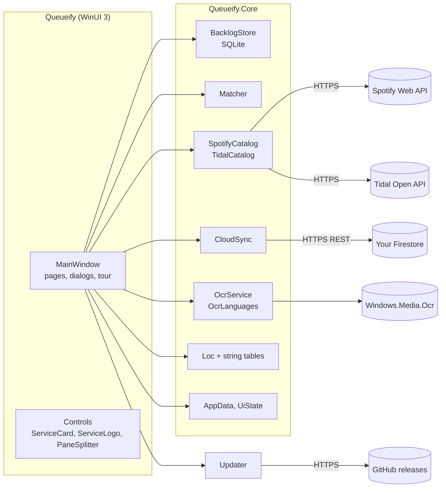

# Architecture

Queueify is a portable WinUI 3 desktop app (Windows App SDK, .NET 10, unpackaged and self-contained,
compiled ahead of time to native code). The download is one exe: a small starter with the app appended,
which it unpacks once per version into `%LOCALAPPDATA%\Queueify\app` ([ADR-0008](adr/0008-native-aot-and-a-starter-exe.md)).

## Projects

| Project | What |
| --- | --- |
| `Queueify\` | The window: navigation, pages (To listen, Listened, Magazine photo, Help, Settings), dialogs, quick tour, theme, assets. `Tr.cs` is the `{l:Tr Key=…}` markup extension. |
| `Queueify.Core\` | Everything that isn't UI. No WinUI references, so it's tested directly. |
| `Queueify.Launcher\` | The download's starter: `Bundle` (append, read and unpack the app, with `X86Filter` and the LZMA SDK in `Lzma\`) and `Program` (unpack, start the app with `QUEUEIFY_EXE`, remove older versions), with `LoadingScreen` (plain Win32) covering the wait. No WinUI. |
| `Queueify.Tests\` | xUnit v3 tests for Core and the starter's `Bundle` and `X86Filter`, on Microsoft Testing Platform. |
| `tests\ui\` | PowerShell + Windows UI Automation tests that drive the published app. |
| `tests\tools\` | Tests for the release tool. |
| `tools\` | `firestore.rules` (embedded into Core), release, packaging and emulator scripts, `make-icon.ps1`; `tools\Pack\` appends the app to the starter at build time. |

## Core services

| Service | Responsibility |
| --- | --- |
| `BacklogStore` | SQLite queue. Rows carry a stable `uid`, `updated_at`, `dirty` and soft `deleted`, for sync. |
| `Matcher` | Splits a typed line into text and year, merges Spotify and Tidal results, scores them. |
| `SpotifyCatalog`, `TidalCatalog` | Album search with the Client Credentials flow; tokens cached per ID and secret. |
| `CloudSync` | Firestore REST: uploads dirty rows, downloads rows newer than the last server time, shared settings. |
| `OcrService`, `OcrLanguages` | Windows OCR on a photo; which language reads it; installing languages (elevated, allow-listed). |
| `Loc`, `Strings.En/Es` | All texts, the app language and the formats that go with it. |
| `AppData`, `UiState` | Where the data folder is; `settings.json` (synced settings, keys) and `ui.json` (per-PC layout, theme, language). |
| `Countries` | The countries where both services work, named in the app language. |
| `Updater` | The latest GitHub release: whether it's newer, downloading and checking its exe, swapping it in ([ADR-0009](adr/0009-update-from-github-releases.md)). |

## Data

Everything lives in `%LOCALAPPDATA%\Queueify`: `queueify.db`, `settings.json`, `ui.json` and, after a crash,
`crash.log`. A `Data` folder next to the exe takes its place when it exists (portable mode, and how 1.1.0
kept it). Copying the folder copies the queue, the keys and the sync connection.

Sync: each PC keeps its own database. Online, a queue is `queues/{key}` in the user's Firestore, where the
40-hex-character key is the capability (the sync code is `queueify:{project}:{key}`). See
[ADR-0003](adr/0003-firestore-rest-sync.md).

## Startup

`App.OnLaunched` reads `ui.json`, sets the language (`Loc.Use` and WinUI's
`PrimaryLanguageOverride`), then creates `MainWindow`, which restores the window, loads settings and the
queue, applies the theme, and syncs once it's loaded. A language change restarts the app, because XAML
reads its texts while it loads.
